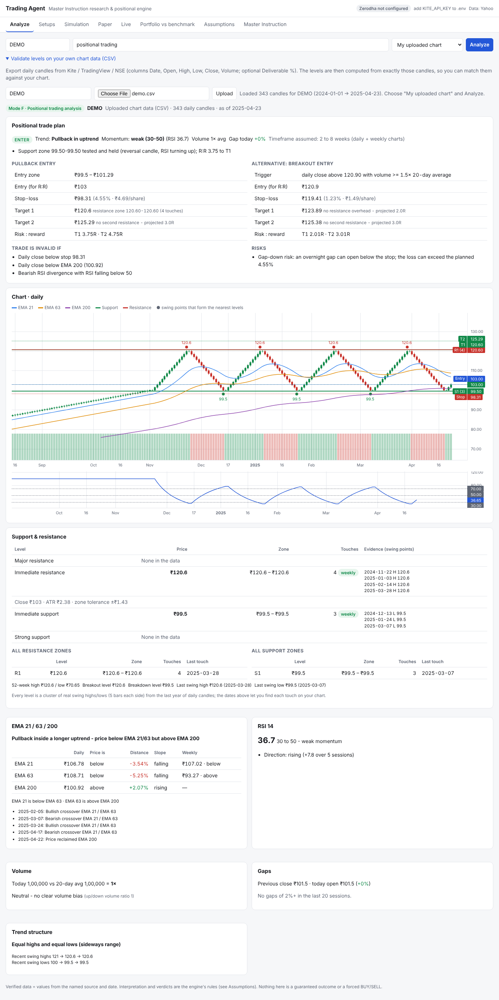
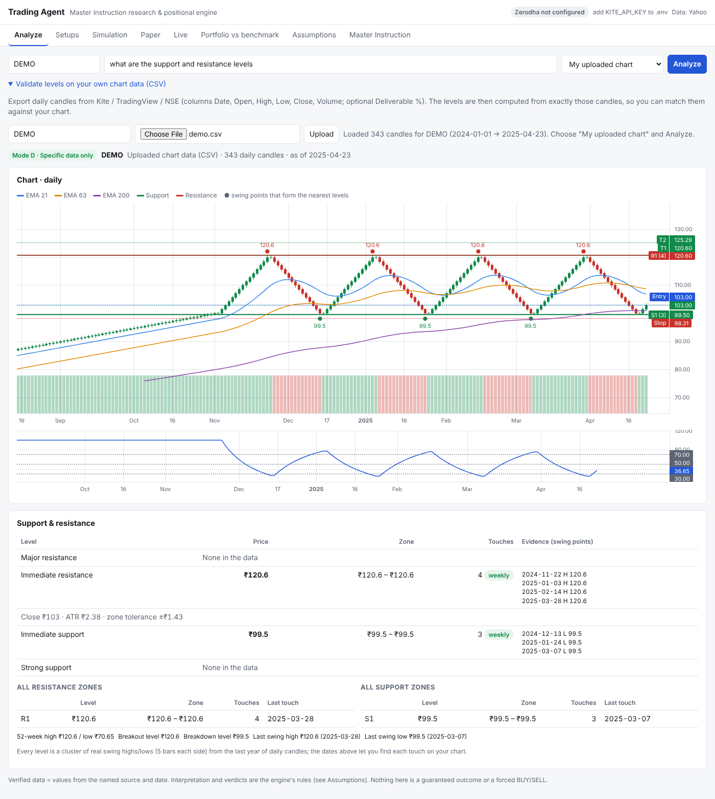
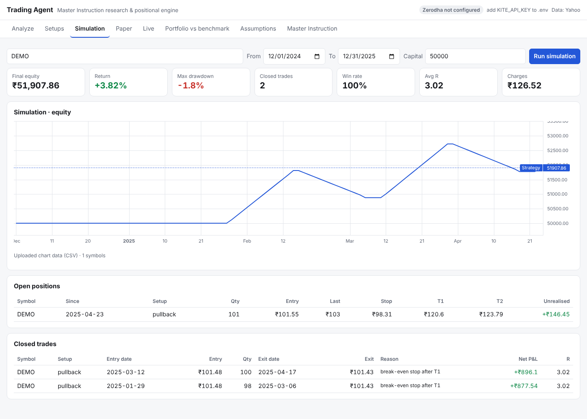
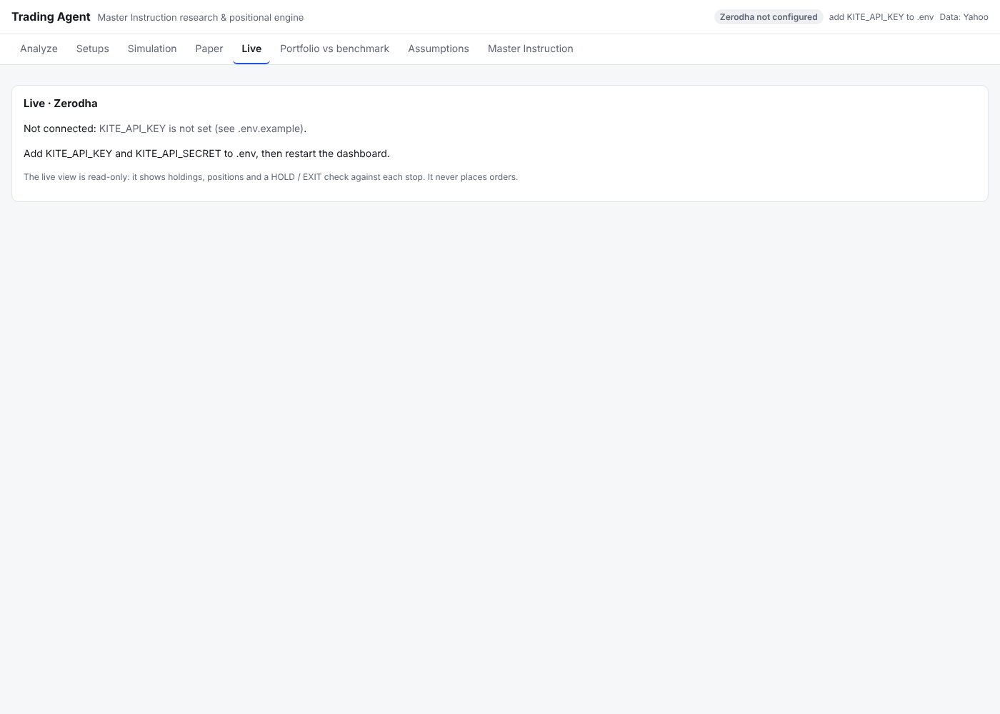
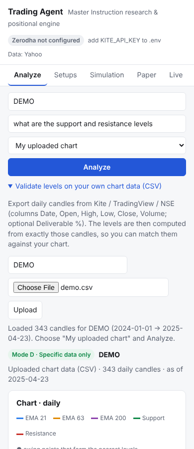
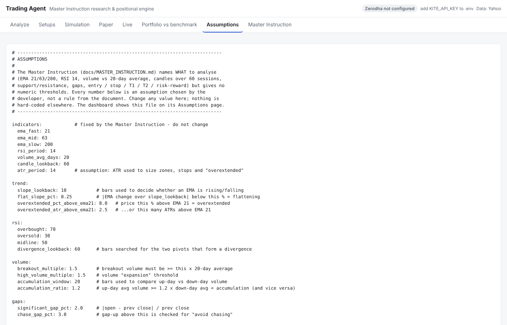

# Trading Agent – Complete Guide

This guide covers everything built for the Trading Agent: what it does, how to install and run it, how every rule works, which numbers are assumptions, where data comes from, what has and has not been verified, and how to merge it into your existing agent folder and push it to GitHub.

---

## Contents

1. [What this is](#1-what-this-is)
2. [Install and run on Windows](#2-install-and-run-on-windows)
3. [Connect Zerodha (live data)](#3-connect-zerodha-live-data)
4. [Using the dashboard, tab by tab](#4-using-the-dashboard-tab-by-tab)
5. [How the agent understands a question (Modes A–F)](#5-how-the-agent-understands-a-question-modes-af)
6. [Technical analysis framework](#6-technical-analysis-framework)
7. [How support and resistance are found](#7-how-support-and-resistance-are-found)
8. [Positional trade decision rules](#8-positional-trade-decision-rules)
9. [Simulation and paper trading](#9-simulation-and-paper-trading)
10. [Fundamentals dashboard and valuation](#10-fundamentals-dashboard-and-valuation)
11. [Portfolio vs benchmark comparison](#11-portfolio-vs-benchmark-comparison)
12. [All assumptions in one table](#12-all-assumptions-in-one-table)
13. [Data sources and their limits](#13-data-sources-and-their-limits)
14. [What has been tested, and what has not](#14-what-has-been-tested-and-what-has-not)
15. [Merging into your existing agent folder](#15-merging-into-your-existing-agent-folder)
16. [Pushing to GitHub](#16-pushing-to-github)
17. [File-by-file map](#17-file-by-file-map)
18. [Troubleshooting](#18-troubleshooting)
19. [Development history](#19-development-history)

---

## 1. What this is

An NSE stock research and positional-trading agent, built **only** on the rules in
[`docs/MASTER_INSTRUCTION.md`](MASTER_INSTRUCTION.md) (a word-for-word copy of your
*Stock market MASTER INSTRUCTION.docx*).

The Master Instruction says **what** to analyse (EMA 21/63/200, RSI 14, volume vs the 20-day average, candles over 60 sessions, support and resistance, gaps, entry, stop, T1, T2 and risk-reward, the Screener dashboard, and benchmark comparison), but it gives **no numeric thresholds**. Every number the code needs that the document does not give is an assumption. All of them are in one file, [`config/assumptions.yaml`](../config/assumptions.yaml), so you can change any of them without touching code.

Ground rules carried over from the document and enforced in code:

- **Analyse only what is asked.** A question about ROCE shows ROCE, not a full report.
- **Never invent numbers.** Anything a source cannot supply is shown as *Unavailable*, with the reason.
- **Show the evidence.** Every support or resistance level lists the dates and prices of the swing points that formed it.
- **Never force BUY/SELL.** Verdicts are ENTER / WAIT / AVOID CHASING / AVOID (and HOLD / EXIT for positions you hold), and each one comes with its reasons, the conditions that invalidate it, and its risks.
- **Read-only with your broker.** The dashboard never places, modifies or cancels orders.



---

## 2. Install and run on Windows

You need Python 3.11 or newer (3.13 is what was tested).

```bat
cd "C:\Users\Admin\OneDrive\Desktop\Trading Agent"
python -m venv .venv
.venv\Scripts\activate
pip install -r requirements.txt
copy .env.example .env
python -m web.app
```

Open **http://127.0.0.1:5000** in your browser. Stop the server with `Ctrl+C`.

Run the tests at any time:

```bat
python -m pytest
```

You should see `37 passed`.

> If OneDrive is syncing the folder, it can lock files while you run. Pausing OneDrive sync,
> or keeping the project outside OneDrive, avoids "file in use" errors.

---

## 3. Connect Zerodha (live data)

Without Zerodha the dashboard uses **Yahoo Finance** for prices.

**No keys (default):** click **Connect Zerodha** (top right), log in on Zerodha's page, then return to the dashboard. With no `KITE_API_KEY` set, the dashboard uses Zerodha's hosted Kite MCP server (`master_agent/data/kite_mcp.py`). That server also offers order tools, so the client only allows a fixed list of read-only ones. The login session is saved in `state/kite_mcp_session.json`, which is excluded from Git, and expires like any Zerodha login.

**Your own Kite Connect app (used instead when `KITE_API_KEY` is set):**

1. Create a Kite Connect app at <https://developers.kite.trade> (Kite Connect is a paid Zerodha API subscription).
2. In the app settings, set the **Redirect URL** to `http://127.0.0.1:5000/kite/callback`.
3. Put the app's key and secret in `.env`:
   ```
   KITE_API_KEY=your_key
   KITE_API_SECRET=your_secret
   ```
4. Restart the dashboard and click **Connect Zerodha** (top right). Log in on the Zerodha page and you are sent back to the **Live** tab.

The access token is valid for that trading day only (a Zerodha rule), so you click **Connect Zerodha** once each morning. The token is saved in `state/kite_session.json`, and `state/` is excluded from Git.

**What Zerodha provides here:** daily candles, last prices, holdings, positions and GTT stops.
**What it does not provide:** fundamentals, delivery %, index TRI values and mutual-fund NAVs. Those come from the sources in [section 13](#13-data-sources-and-their-limits).

> "Connectors" in the Claude app (the Zerodha MCP connector) and Kite Connect in this dashboard are
> separate. The connector lets Claude read your account during a chat. The dashboard uses your own
> Kite Connect app keys.

---

## 4. Using the dashboard, tab by tab

### Analyze
- Type a **symbol** (e.g. `RELIANCE`) and a **question** in plain words, then click **Analyze**.
- **Data source**: *Auto* (Kite if connected, otherwise Yahoo), *Zerodha Kite*, *Yahoo Finance* or *My uploaded chart*.
- **Validate levels on your own chart data (CSV)**: upload daily candles exported from Kite, TradingView, NSE or Excel. The analysis then uses exactly your candles, so you can match the support and resistance levels against your own chart.
  - Required columns: Date, Open, High, Low, Close, Volume. Optional: Deliverable % / DELIV_PER.
  - Accepted date formats: `2024-01-02`, `02-01-2024`, `02-Jan-2024`. Commas in numbers are fine.
- The chart shows candles, EMA 21 (blue), EMA 63 (orange) and EMA 200 (purple), volume, support (green) and resistance (red) lines labelled with their touch counts, the plan's Entry, Stop, T1 and T2 lines, and dots on the exact swing candles that form the nearest support and resistance. RSI 14 is drawn below it, with lines at 30, 50 and 70.



### Setups
Scans the symbols in `config/watchlist.yaml` (or the symbols you type) and lists each stock's verdict, entry, stop, T1 and risk-reward, with ENTER first. Click a symbol to open its full analysis.

### Simulation
Back-tests the positional rules day by day over a date range on the symbols you choose, starting with your capital. It shows final equity, return against Nifty 50, maximum drawdown, win rate, average R, charges, open positions and every closed trade.



### Paper
The same engine run from a **paper start date** up to the latest candle. Click **Update paper portfolio** each day to roll it forward. No orders are sent.

### Live
After you connect Zerodha it shows each holding with its quantity, average price, last price, P&L and active GTT stop, plus a **HOLD / EXIT** check:
- the stop used is your GTT trigger if one exists, otherwise the engine's support-based stop;
- **no GTT** is highlighted in red, so an unprotected holding stands out;
- today's positions are listed below the holdings.



### Portfolio vs benchmark
- Enter each purchase (symbol, date, quantity, average price), or click **Load from Zerodha** to fill in symbols, quantities and prices. Zerodha does not report purchase dates, so you add those.
- **Compare with benchmarks** shows your money against the same amounts invested on the same dates in Nifty Smallcap 250 TRI, Nifty Smallcap 100 TRI and Motilal Oswal Small Cap Fund (Direct Growth).
- **What if I had invested…**: for example, ₹1,00,000 three months ago.


### Assumptions / Master Instruction
These show the two files that drive everything. To change a rule, edit `config/assumptions.yaml` and restart the dashboard.

The dashboard also works on a phone-width screen:



---

## 5. How the agent understands a question (Modes A–F)

`master_agent/router.py` reads the question and picks a mode (Master Instruction sections 2 and 5). Only the sections for that mode are shown.

| Mode | Example question | What is shown |
|---|---|---|
| A – Fundamentals only | "TRANSRAIL fundamentals" | Screener dashboard first, then fundamentals |
| B – Technicals only | "TRANSRAIL technicals", "is it bullish?" | Chart, EMA, RSI, candles, volume, delivery, levels, gaps, trend |
| C – Combined | "complete analysis", "is this a good investment?" | Dashboard, fundamentals, chart, technicals, trade plan |
| D – Specific data | "ROCE, ROE and debt-to-equity", "only EMA 21, 63 and 200", "support and resistance", "last three quarterly results" | Only those items |
| E – Comparison | "compare TCS vs INFY" | Side-by-side metrics, EMA structure and setup |
| F – Positional trade | "positional trading", "entry and stop-loss" | Trade plan plus the technicals a trader needs |
| V – Valuation | "is it overvalued?" | Graham Number, margin of safety, DCF calculator |
| P – Portfolio | "compare my portfolio with Motilal Oswal Small Cap" | Sends you to the Portfolio tab |
| Q – Quick update | "quick update" | Four-line summary |

If no scope is given (just a symbol), the technical analysis is shown and the page says that it assumed this.

---

## 6. Technical analysis framework

All of this lives in `master_agent/technical.py` and `master_agent/indicators.py`.

| Item | How it is calculated |
|---|---|
| EMA 21 / 63 / 200 | Standard exponential moving average on daily closes. Also calculated on weekly candles (weeks end Friday). |
| EMA slope | Change over 10 bars; under 0.25% counts as *flattening*. |
| EMA structure | *Strong uptrend* (price > 21 > 63 > 200, with 63 and 200 rising), *Uptrend*, *Pullback in a longer uptrend*, *Downtrend*, *Weak* or *Mixed*. Price above EMA 21 alone is never called bullish. |
| Crossovers / reclaims / rejections | 21/63 and 63/200 crossovers in the last 60 bars; reclaims of and rejections at each EMA in the last 10 bars. |
| Overextended | More than 8% above EMA 21, or more than 2.5 ATR above it. |
| RSI 14 | Wilder's RSI, seeded the same way as Kite and TradingView. It matches the published Wilder reference values (tested). |
| RSI zones | Above 70 overbought, 50–70 positive, 30–50 weak, below 30 oversold. None of these is an automatic buy or sell. |
| Divergence | Compares the last two swing lows (bullish) or swing highs (bearish) of price and RSI within 60 bars. |
| Failure swings | Bullish: RSI below 30, bounces, holds above 30 on the retest, then breaks its earlier peak. Bearish is the mirror image. |
| Candles (last 60 sessions) | Bullish and bearish engulfing, hammer, hanging man, shooting star, inverted hammer, doji, inside bar, morning and evening star, strong breakout candle, long-wick rejections. Each is reported with whether it closed above or below EMA 21. |
| Volume | Today vs the 20-day average; high-volume days (≥ 1.5×); accumulation or distribution from up-day vs down-day volume over 20 days (ratio ≥ 1.2). |
| Delivery % | Current, 5-, 10- and 20-day averages, and averages on up days vs down days, from NSE's daily files. |
| Gaps | Gaps of 2% or more in the last 20 sessions, with whether each has filled and its volume. |
| Trend structure | Higher highs / higher lows and so on. Swings within the zone tolerance count as *equal*, so a flat range reads as sideways rather than as a downtrend. Also flags false breakouts and breakdowns. |

---

## 7. How support and resistance are found

This is `master_agent/levels.py`. The goal: **every level must be a real price where the stock turned, and you must be able to find it on your chart.**

1. **Swing points.** Over the last 250 daily candles, a candle is a *swing high* if its high is the highest of the 5 candles before and the 5 after it; a *swing low* is the same with lows. (If two candles tie, the first one counts.)
2. **Zones.** Swing points closer together than the tolerance merge into one zone. The tolerance is max(0.6 × ATR, 0.75% of price). The zone's *level* is the average of its swing prices, and its *low* and *high* are the lowest and highest of them. A zone is never wider than twice the tolerance.
3. **Support or resistance.** Zones below the latest close are support; zones at or above it are resistance. A zone made of both swing highs and swing lows is marked **role reversal** (old resistance that became support, or the other way round).
4. **Weekly confirmation.** If a weekly swing point (3 weeks either side) falls inside a daily zone, the zone is marked **weekly** and counts as one extra touch.
5. **Labels.**
   - *Immediate support / resistance* is the nearest zone below / above the price.
   - *Strong support / major resistance* is the nearest other zone with 3 or more touches (or the strongest one left).
   - *Breakout level* is the top of the immediate resistance zone; *breakdown level* is the bottom of the immediate support zone.
   - The 52-week high and low, the last swing high and low, and the consolidation range (when the last 20 sessions sit within 3 ATR) are also shown.
   - With no resistance above the price, the page says **price discovery** instead of making a level up.
6. **Evidence.** Each zone lists its swing points (date, price, H or L). A test checks that every listed price is the actual high or low of the candle on that date.

**Why a level can differ slightly from what you draw by eye:** the level is the *average* of the swing prices, and the zone shows the full range. Compare the **zone** (low – high) with your line. If you want tighter or wider zones, change `zone_tolerance_atr` / `zone_tolerance_min_pct`. To use only bigger swings, raise `pivot_bars`.

**Checking against your own chart:** export the same daily candles you are looking at as CSV and upload them on the Analyze tab. The levels are then calculated from exactly those candles.

---

## 8. Positional trade decision rules

This is `master_agent/positional.py`: Master Instruction 2F and 3I, long-only cash-equity trades with an assumed holding period of 2–8 weeks.

### Two kinds of entry

**Pullback entry (buy at support)**
- *Entry zone*: from the immediate support level up to the top of the zone plus 0.75 ATR.
- *Support tested*: today's or yesterday's low traded inside the entry zone and the close is still above the zone's bottom.
- *Confirmation* (RSI below 30 alone is never a buy): a bullish reversal today (close above the open **and** above the previous high, or a hammer / bullish engulfing / morning star), RSI higher than yesterday, and no bearish divergence.
- *Stop*: 0.5 ATR below the support zone's low.

**Breakout entry (buy strength)**
- *Trigger*: a daily close above yesterday's immediate resistance zone.
- *Volume*: at least 1.5× the 20-day average, otherwise the breakout is reported as **not confirmed**.
- *Stop*: 0.5 ATR below the old resistance zone (which should now act as support).
- If there is no breakout today, the page shows the breakout as an **alternative** plan, with its trigger price (resistance + 0.25%).

### Targets and risk-reward
- **T1** = the low of the next resistance zone above the entry; **T2** = the zone after that.
- With no resistance above (price discovery): T1 = entry + 2R and T2 = entry + 3R, labelled **projected**.
- **R:R** = (target − entry) ÷ (entry − stop), using the actual prices shown.

### Verdict, checked in this order

| Verdict | When |
|---|---|
| **AVOID** | Not an uptrend: price is below EMA 200, or EMA 63 is below EMA 200. Also when there is too little data, in which case it says the setup cannot be confirmed. |
| **ENTER** (breakout) | A confirmed breakout today with R:R ≥ 2, a stop within 8% and no 3%+ gap-up |
| **AVOID CHASING** | A breakout on a 3%+ gap-up (wait for a retest), or price overextended above EMA 21, or a 3%+ gap-up away from support |
| **WAIT** | A breakout on weak volume |
| **ENTER** (pullback) | Support tested and confirmed, with R:R ≥ 2 and a stop within 8% |
| **WAIT** | Anything else; the reason says why (e.g. "Price is 1.4 ATR above the entry zone", or "R:R 1.6 is below the 2.0 minimum") |

### For a position you hold
- **EXIT** if the close is below the stop, or below the invalidation EMA: EMA 63 when the entry was above EMA 63, EMA 200 when it was a deeper pullback between EMA 63 and EMA 200.
- Otherwise **HOLD**.

Every plan also lists what would **invalidate** the trade and its **risks**. Gap-down risk is always shown, because an overnight gap can open below the stop.

---

## 9. Simulation and paper trading

This is `master_agent/simulate.py`.

- **No look-ahead.** The decision on day *t* uses candles up to day *t* only. Orders fill at day *t+1*'s open. A test confirms that adding future data does not change past results.
- **Fills.** If the next open has already gapped below the stop, beyond the 8% stop limit, or above T1, the trade is skipped rather than chased.
- **Size.** Risk 1% of equity per trade, with no more than 20% of equity in one stock and only the cash available.
- **During the trade** (stop checked first, to be conservative):
  - open below the stop → exit at the open;
  - low touches the stop → exit at the stop;
  - high reaches T1 → sell half and move the stop to the entry price (break-even);
  - high reaches T2 → sell the rest;
  - close beyond the invalidation EMA → exit at the next open.
- **Limits.** At most 5 open positions. When there are more ENTER signals than free slots, the best R:R wins.
- **Costs.** 0.12% per side plus ₹15.93 DP charge per sell, and 0.05% slippage.
- **Benchmark.** Nifty 50 price index, scaled to the same starting capital.
- **Paper trading** is this same simulation from your paper start date to the latest candle, so paper results always match what the rules would have done.

---

## 10. Fundamentals dashboard and valuation

This is `master_agent/fundamentals.py` (Master Instruction Module 1).

- Values come from the public **Screener.in** company page (consolidated first, then standalone).
- The dashboard shows the metrics in the exact order the document gives, grouped under Valuation, Financial Strength, Profitability, Ownership and Performance, with Face Value included.
- The following are calculated from Screener's tables:
  - Change in Promoter / FII / DII holding (latest quarter vs the one before);
  - QoQ sales growth and variation;
  - OPM.
- **Graham Number** = √(22.5 × EPS × Book value per share), using TTM EPS and the stated book value. The formula and inputs are shown. It is undefined for negative EPS or book value, and the page says so.
- **Intrinsic value (DCF)**: a two-stage DCF that you fill in yourself. You enter the free-cash-flow base, number of shares, growth rate, years, discount rate, terminal growth and net debt. It returns the value per share, the share of value coming from the terminal value, and a sensitivity table (discount rate ±2%, terminal growth ±1%). It is not calculated automatically, because a reliable FCF base cannot be read from the public page, and the document says not to present an estimate as fact.
- **Unavailable:** ROIC, pledged %, industry P/E and, on some pages, cash cycle are custom ratios that Screener shows only to logged-in users, so they appear as *Unavailable*.

---

## 11. Portfolio vs benchmark comparison

This is `master_agent/portfolio.py` (Master Instruction Module 3).

- **Per lot:** investment = quantity × price; current value = quantity × current price; P&L; return %; holding days; CAGR (only when held 1 year or more).
- **Same money, same date:** every lot is mirrored by a benchmark purchase of the same rupee amount on the same date. Benchmark units = amount ÷ the index or NAV value on that date.
- **Non-trading days:** a purchase on a holiday or weekend uses the next trading day, and the page says so.
- **One valuation date:** all series are valued on the latest date that every one of them has data for.
- **Corporate actions:** stock splits and bonuses scale your original quantity (Yahoo provides split data). Dividends are added to total return when the price source provides them (Yahoo does; Kite does not).
- **Portfolio results:** total value, P&L, return, each stock's weight (from the actual amounts, never assumed equal), each stock's contribution to the portfolio return, best and worst stock, and outperformance in percentage points against each benchmark.
- **Risk:** annualised volatility and maximum drawdown for each stock and each benchmark over the same period.
- **Benchmarks:**
  - Nifty Smallcap 250 TRI and Nifty Smallcap 100 TRI come from niftyindices.com, using the Total Return Index, not the price index.
  - Motilal Oswal Small Cap Fund is looked up by name in AMFI data. The match must contain both "direct" and "growth", so plans are never mixed, and the exact scheme name and code are shown.
- **Unavailable benchmark:** if a benchmark cannot be fetched, it is listed as unavailable with the reason, and no number is estimated. You can drop your own export at `state/benchmarks/<id>.csv`, where the id is `smallcap250_tri`, `smallcap100_tri` or `motilal_smallcap_direct`.

---

## 12. All assumptions in one table

All of these live in `config/assumptions.yaml`. The Master Instruction fixes only the indicator periods (EMA 21/63/200, RSI 14, 20-day volume average, 60 candles). Everything else here was chosen by the developer.

| Area | Setting | Value |
|---|---|---|
| Indicators | ATR period | 14 |
| Trend | EMA slope lookback / flat threshold | 10 bars / 0.25% |
| Trend | Overextended | > 8% or > 2.5 ATR above EMA 21 |
| RSI | Overbought / midline / oversold | 70 / 50 / 30 |
| RSI | Divergence search window | 60 bars |
| Volume | Breakout confirmation / high-volume day | ≥ 1.5× 20-day average |
| Volume | Accumulation (distribution) | up-day volume ≥ 1.2× down-day volume (or the reverse) |
| Gaps | Significant gap / "chasing" gap-up | 2% / 3% |
| S/R | Lookback / swing size | 250 days / 5 candles each side |
| S/R | Zone tolerance | max(0.6 × ATR, 0.75% of price) |
| S/R | Strong / major level | 3+ touches (a weekly swing adds 1) |
| S/R | Weekly swing size | 3 weeks each side |
| S/R | Consolidation | last 20 sessions within 3 ATR |
| Trade | Assumed holding period | 2–8 weeks |
| Trade | Pullback entry zone | support level up to zone high + 0.75 ATR |
| Trade | Pullback confirmation | bullish reversal candle + RSI rising + no bearish divergence |
| Trade | Stop | 0.5 ATR below the zone low; reject if > 8% |
| Trade | Minimum R:R for ENTER | 2.0 to T1 |
| Trade | Breakout entry | resistance + 0.25% |
| Trade | Projected targets | 2R / 3R when there is no resistance above |
| Trade | Invalidation | close below EMA 63 (or EMA 200 for deep pullbacks) |
| Simulation | Capital / risk per trade | ₹50,000 / 1% |
| Simulation | Max position / max open positions | 20% / 5 |
| Simulation | At T1 | sell 50%, stop moves to entry |
| Simulation | Charges / DP / slippage | 0.12% per side / ₹15.93 per sell / 0.05% |
| Portfolio | CAGR shown from | 365 days held |



---

## 13. Data sources and their limits

| Data | Source | Limits |
|---|---|---|
| Daily candles | Zerodha Kite (`master_agent/data/kite.py`) | Needs a Kite Connect subscription; the token expires daily; up to 2,000 days per request (handled automatically) |
| Daily candles | Yahoo Finance (`data/yahoo.py`) | Free and unofficial; split-adjusted closes; occasionally missing days |
| Daily candles | Your CSV upload | Used exactly as provided |
| Delivery % | NSE `sec_bhavdata_full` daily files (`data/nse_delivery.py`) | One download per day, cached in `state/nse_cache`; NSE sometimes blocks automated requests, in which case delivery shows as *Unavailable* |
| Fundamentals | Screener.in public page | Login-only ratios are unavailable; the page layout can change |
| Index TRI | niftyindices.com (`data/benchmarks.py`) | Unofficial endpoint; you can use a manual CSV instead |
| Fund NAV | AMFI via api.mfapi.in | Scheme matched by name and plan words |

---

## 14. What has been tested, and what has not

**Tested (37 automated tests, all passing):**
- RSI against Wilder's published reference values; EMA against the standard formula; tie handling for swing points.
- Support and resistance on a known price range: the right levels, at least 3 touches each, and every evidence price is a real candle high or low.
- Price discovery (no made-up resistance) and the "not enough data" case.
- The full technical report, the trade plan arithmetic (R:R calculated from the actual prices), AVOID in a downtrend, and HOLD / EXIT for held positions.
- Simulation: runs end to end, and no look-ahead (future data does not change past results).
- Portfolio maths: the formulas, same amount and date for benchmarks, weekend dates moved to the next trading day, weights from the actual amounts, split adjustment, and unavailable benchmarks reported rather than estimated.
- Screener page parsing, dashboard order, Graham Number and DCF sensitivity.
- Question routing for every example in the Master Instruction.
- CSV loading: ISO dates, NSE day-first dates, commas, Kite timezones.
- The dashboard in a real browser (Chromium): upload, analyze, levels, simulation, live and mobile views, with no browser errors.

**Not yet tested** (the development machine could not reach these sites; they are expected to work on your PC):
- Live calls to Zerodha Kite, Yahoo Finance, NSE, Screener.in, niftyindices.com and mfapi.in.
- Support and resistance on **real** stocks. Before relying on the levels, upload a few real charts you know well, or connect Zerodha, and compare.

---

## 15. Merging into your existing agent folder

Your existing agent code (with the Zerodha order fixes and the earlier `trend` strategy) lives in `C:\Users\Admin\OneDrive\Desktop\Trading Agent`. Your instructions were to keep the code, delete the simulation data and results, and replace the old instructions with the Master Instruction.

1. **Back up first.** Copy the whole folder to, say, `Trading Agent BACKUP`.
2. **Delete simulation data and results.** Typically the `results\`, `simulations\` and `paper\` folders, any `*.csv` / `*.json` outputs from back-tests, and old logs.
3. **Delete the old instructions.** Any older strategy or instruction documents and prompt files (for example a `CLAUDE.md`, `strategy.md` or `rules.md` that described the old rules). Keep code files.
4. **Copy in this package.** Unzip it and copy everything into the folder:
   - `master_agent\`, `web\`, `config\`, `docs\`, `tests\`, `requirements.txt`, `.env.example`, `.gitignore`, `README.md`
   - If your folder already has a `config\` or `tests\` folder, the new files sit beside the old ones. Delete old config files that described the old strategy.
5. **Reinstall and test:**
   ```bat
   .venv\Scripts\activate
   pip install -r requirements.txt
   python -m pytest
   ```
6. **Point your existing order code at the new rules.** Your agent's buy/sell loop should ask `master_agent.positional.plan(df)` for the verdict, entry, stop and targets, instead of the old `trend` strategy. Keep the existing Zerodha safety logic: placing the new GTT before cancelling the old one, `ensure_protection()`, and the double-buy check.

If you push your folder to GitHub (next section), Claude can do steps 2–6 for you, including wiring the order code to the new rules.

---

## 16. Pushing to GitHub

1. Create an empty repository named `TradingAgent` at <https://github.com/new>.
2. From inside the project folder:
   ```bat
   git init
   git add .
   git commit -m "Trading Agent on Master Instruction"
   git branch -M main
   git remote add origin https://github.com/hemanthsamudrala55/TradingAgent.git
   git push -u origin main
   ```
3. `.gitignore` already keeps `.env` (your API keys), `.venv\`, `state\`, `results\` and `simulations\` out of GitHub.
4. To let Claude work on the repository in a cloud session, install the Claude GitHub app on it at <https://claude.ai/connect-github>.

---

## 17. File-by-file map

```
TradingAgent/
├── README.md                     short overview and run commands
├── requirements.txt              Python packages
├── .env.example                  template for Kite keys (copy to .env)
├── .gitignore
├── config/
│   ├── assumptions.yaml          every threshold (edit here)
│   └── watchlist.yaml            symbols for Setups / Simulation / Paper
├── docs/
│   ├── MASTER_INSTRUCTION.md     your instruction document (the only rule source)
│   ├── GUIDE.md                  this guide
│   └── images/                   screenshots used in this guide
├── master_agent/
│   ├── config.py                 loads assumptions.yaml
│   ├── indicators.py             EMA, Wilder RSI/ATR, weekly candles, swing points
│   ├── levels.py                 support & resistance zones with evidence
│   ├── candles.py                candlestick patterns
│   ├── technical.py              full technical report (sections 3A–3H)
│   ├── positional.py             trade plan and verdict (section 3I)
│   ├── fundamentals.py           Screener dashboard, Graham Number, DCF
│   ├── portfolio.py              portfolio vs benchmarks (Module 3)
│   ├── simulate.py               simulation and paper engine
│   ├── router.py                 question → Mode A–F
│   └── data/
│       ├── __init__.py           CSV loader / column normaliser
│       ├── kite.py               Zerodha Kite Connect
│       ├── yahoo.py              Yahoo Finance
│       ├── nse_delivery.py       NSE delivery %
│       └── benchmarks.py         Nifty TRI and fund NAVs
├── web/
│   ├── app.py                    Flask server and API
│   ├── templates/index.html      dashboard page
│   └── static/                   app.js, app.css, lightweight-charts.js (Apache-2.0)
└── tests/                        37 automated tests
```

---

## 18. Troubleshooting

| Problem | Fix |
|---|---|
| `Port 5000 is in use` | Another copy is running. Close it, or start with `set PORT=5050` then `python -m web.app`. |
| "Price data unavailable from Yahoo Finance" | Check the symbol (NSE symbol, without `.NS`). Yahoo occasionally fails; try again or use Kite. |
| "Zerodha not configured" | Add `KITE_API_KEY` and `KITE_API_SECRET` to `.env` and restart. |
| Kite login loops or fails | The redirect URL in the Kite app must be exactly `http://127.0.0.1:5000/kite/callback`. |
| Kite worked yesterday, not today | The daily token expired. Click **Connect Zerodha** again. |
| Delivery % is "Unavailable" | NSE blocked the download. Try later, or upload a CSV that has a Deliverable % column. |
| Fundamentals unavailable | Screener.in was unreachable or the symbol differs there. Open `https://www.screener.in/company/<SYMBOL>/` to check. |
| Benchmark unavailable | niftyindices.com or mfapi.in was unreachable. Download the TRI history from niftyindices.com and save it as `state/benchmarks/smallcap250_tri.csv`. |
| "EMA 200 needs 200 candles" | A newly listed stock, or the CSV is too short. Upload at least 1 year of data, and 3 years for everything. |
| Levels look different from my chart | Upload your exact candles as CSV (see section 7) and compare zones rather than single lines. |

---

## 19. Development history

What was built across the sessions, for reference:

1. **Zerodha safety fixes** (in your existing agent code, not this package):
   - a trailing-stop update can no longer remove protection, because the new GTT is placed before the old one is cancelled;
   - a failed GTT after a buy is detected, and a continuous `ensure_protection()` check repairs it;
   - GTT exit P&L is recorded correctly, and partial GTT fills are reconciled;
   - a pre-buy order check prevents double buys after a crash.
2. **The `trend` strategy and its tests** (EMA 20/50/200 based). These have now been replaced by the Master Instruction rules.
3. **Rejected improvement attempts** (momentum rotation, a sector limit and a Nifty filter). Each was rejected after walk-forward testing.
4. **This package**: the Master Instruction engine, the dashboard, the tests and this guide. The rules now follow only the Master Instruction, with the assumptions listed in section 12.
